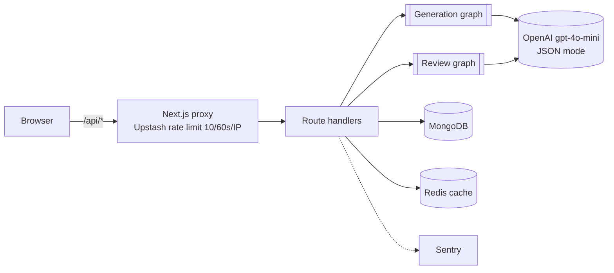
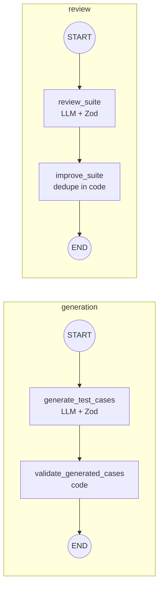

<div align="center">

# TestMind

**An AI QA engineering workspace.** Describe a feature like a ticket and get back a reviewed, deduplicated test suite of happy, negative and edge cases. Every model call is schema-checked and traced.

[**Live demo →**](https://testmind-production.up.railway.app/) · [Architecture](https://testmind-production.up.railway.app/architecture) · [E2E test](tests/e2e/testmind-complete-flow.spec.ts)

`Next.js 16` · `React 19` · `TypeScript` · `LangGraph` · `OpenAI` · `MongoDB` · `Upstash Redis` · `Playwright` · `Sentry` · `Docker`

<!-- Add screenshots: docs/suite.png (suite page with a finished pipeline trace) and docs/architecture.png -->

</div>

---

## The problem

Writing test cases is slow, and the cases people skip are the negative and edge ones. LLMs can draft them, but raw model output is unreliable: wrong shapes, duplicates, made-up fields. TestMind treats the model as **one unreliable step inside a deterministic pipeline**.

## What it does

1. **Describe:** write the feature spec.
2. **Generate:** a LangGraph workflow drafts 1–8 cases (happy / negative / edge) and validates them against a schema.
3. **Review:** a second workflow scores coverage from 0 to 100, names the missing areas and proposes new cases.
4. **Improve:** accept suggestions. They're merged and deduped in code. The next generation sees the last review, so regeneration targets the gaps.
5. **Export:** download JSON or a **Playwright spec skeleton** with one `test()` per case and steps as `test.step`.

Each run shows a **live pipeline trace**: the graph's nodes, how long each took, the model, and the token count, reported by the server.

## Architecture





### Engineering decisions

| Decision | Why | Where |
|---|---|---|
| **LangGraph instead of one chain** | Typed shared state lets me validate between steps, add the review loop without touching generation, and trace each node. | [`src/lib/ai/graph`](src/lib/ai/graph) |
| **One topology module** | The compiled graphs and the UI diagram import the same node list, so the diagram can't drift from the code. | [`topology.ts`](src/lib/ai/graph/topology.ts) |
| **Per-node tracing** | A wrapper records duration, model and token usage into an append-only state channel. The API returns it and the UI renders it. | [`trace.ts`](src/lib/ai/graph/trace.ts) |
| **JSON mode + Zod** | Bad model output fails the run instead of reaching the UI or the database. | [`schemas/`](src/lib/ai/schemas) |
| **Deterministic post-processing** | Normalization and dedupe (type + normalized title) are plain code, not prompts: testable and free. | [`utils/test-case.ts`](src/lib/ai/utils/test-case.ts) |
| **Persist only after a clean run** | Orchestrators throw if any node reported an error, so there are no half-written suites. | [`suite-orchestrator/`](src/lib/ai/services/suite-orchestrator) |
| **Edge rate limiting** | Upstash fixed window in the Next.js proxy protects the LLM budget. | [`proxy.ts`](src/proxy.ts) |
| **Redis read cache** | Suite and project reads are cached with `s-maxage` / `stale-while-revalidate` and an `X-Cache` marker. | [`cache.ts`](src/lib/cache.ts) |

### Results

| | Before | After |
|---|---|---|
| Cached API throughput (autocannon) | ~40 req/s | **420+ req/s** |
| API latency | ~2.5 s | **~250 ms** |
| Docker image | 1.18 GB | **281 MB** (multi-stage, standalone output) |

## Testing

The Playwright test drives the real UI end to end: create project → add feature → generate → review → accept a suggestion. It intercepts the three AI routes with fixtures, so it's **deterministic, fast and costs nothing**. The fixtures deliberately include malformed shapes (uppercase types, a non-array `suggestions`) to prove the UI tolerates them.

```bash
npm run test:e2e
```

## Production

- **Docker:** multi-stage build of Next's `standalone` output ([`Dockerfile.prod`](Dockerfile.prod))
- **PM2:** cluster mode, 2 instances, restart at 350 MB ([`ecosystem.config.js`](ecosystem.config.js))
- **Sentry:** client, server and edge, tunneled via `/monitoring`
- **Hosting:** Railway

## What I'd do next

- **Stream node progress** over SSE so each node lights up as it finishes. Today the trace arrives when the run ends.
- **Prompt regression evals** in CI: a fixed set of specs with expected coverage.
- **Per-route limits:** a cheap read shouldn't cost the same as an LLM call.
- **Auth and multi-tenancy:** projects are global today.

## Run locally

```bash
git clone https://github.com/vini1237777/TestMind.git && cd TestMind
npm install
cp .env.example .env.local   # fill in the values
npm run dev
```

| Variable | Used for |
|---|---|
| `OPENAI_API_KEY` | generation and review |
| `MONGODB_URI` | persistence |
| `UPSTASH_REDIS_REST_URL`, `UPSTASH_REDIS_REST_TOKEN` | rate limiting and cache |
| `NEXT_PUBLIC_SENTRY_DSN`, `SENTRY_DSN` | error monitoring (optional) |

```bash
docker build -f Dockerfile.prod -t testmind . && docker run -p 8080:8080 --env-file .env.local testmind
```

---

Built by [Vinisha Yadav](https://github.com/vini1237777).
