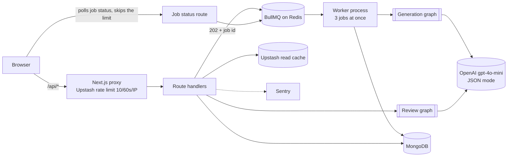
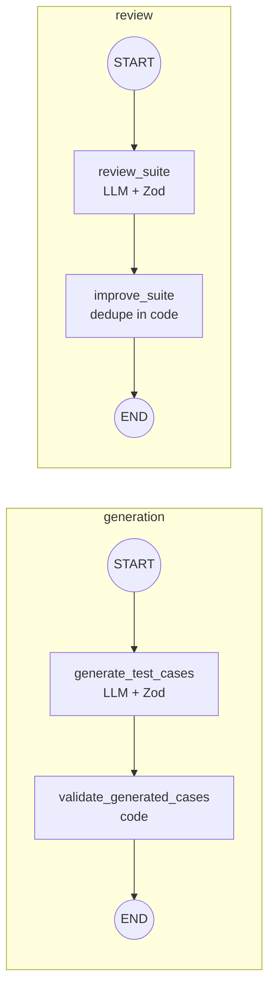

<div align="center">

# TestMind

**An AI QA engineering workspace.** Describe a feature like a ticket and get back a reviewed, deduplicated test suite of happy, negative and edge cases. Every model call is schema-checked and traced.

[**Live demo →**](https://testmind-production.up.railway.app/) · [Architecture](https://testmind-production.up.railway.app/architecture) · [E2E test](tests/e2e/testmind-complete-flow.spec.ts)

`Next.js 16` · `React 19` · `TypeScript` · `LangGraph` · `OpenAI` · `MongoDB` · `BullMQ` · `Redis` · `Playwright` · `Sentry` · `Docker`

<!-- Add screenshots: docs/suite.png (suite page with a finished pipeline trace) and docs/architecture.png -->

</div>

---

## Architecture



Generation runs in the background because a model call takes seconds. The API answers straight away and a separate worker does the slow part. Reviews still run inside the request.

## The problem

Writing test cases is slow, and the cases people skip are the negative and edge ones. LLMs can draft them, but raw model output is unreliable: wrong shapes, duplicates, made-up fields. TestMind treats the model as **one unreliable step inside a deterministic pipeline**.

## What it does

1. **Describe:** write the feature spec.
2. **Generate:** a LangGraph workflow drafts 1–8 cases (happy / negative / edge) and validates them against a schema.
3. **Review:** a second workflow scores coverage from 0 to 100, names the missing areas and proposes new cases.
4. **Improve:** accept suggestions. They're merged and deduped in code. The next generation sees the last review, so regeneration targets the gaps.
5. **Export:** download JSON or a **Playwright spec skeleton** with one `test()` per case and steps as `test.step`.

Each run shows a **live pipeline trace**: the graph's nodes, how long each took, the model, and the token count, reported by the server.

## How each run works



### Engineering decisions

| Decision | Why | Where |
|---|---|---|
| **LangGraph instead of one chain** | Typed shared state lets me validate between steps, add the review loop without touching generation, and trace each node. | [`src/lib/ai/graph`](src/lib/ai/graph) |
| **One topology module** | The compiled graphs and the UI diagram import the same node list, so the diagram can't drift from the code. | [`topology.ts`](src/lib/ai/graph/topology.ts) |
| **Per-node tracing** | A wrapper records duration, model and token usage into an append-only state channel. The API returns it and the UI renders it. | [`trace.ts`](src/lib/ai/graph/trace.ts) |
| **JSON mode + Zod** | Bad model output fails the run instead of reaching the UI or the database. | [`schemas/`](src/lib/ai/schemas) |
| **Deterministic post-processing** | Normalization and dedupe (type + normalized title) are plain code, not prompts: testable and free. | [`utils/test-case.ts`](src/lib/ai/utils/test-case.ts) |
| **Persist only after a clean run** | Orchestrators throw if any node reported an error, so there are no half-written suites. | [`suite-orchestrator/`](src/lib/ai/services/suite-orchestrator) |
| **Edge rate limiting** | Upstash fixed window in the Next.js proxy protects the LLM budget. | [`proxy.ts`](src/proxy.ts) |
| **Background worker for generation** | A model call takes seconds. The API returns a job id immediately, and concurrency stays capped at 3 however many requests arrive. | [`generation-worker.ts`](src/worker/generation-worker.ts) |
| **Polling instead of SSE** | It survives proxies and restarts and needs no open connection, at the cost of up to 1.5s extra delay. The status route only reads job state, so it skips the rate limit. | [`generate-tests.ts`](src/app/lib/generate-tests.ts) |
| **Separate Redis for the queue** | BullMQ needs a TCP connection, which Upstash REST doesn't offer, and its constant polling doesn't suit per-command pricing. | [`generation-queue.ts`](src/lib/queue/generation-queue.ts) |
| **Redis read cache** | Suite and project reads are cached with `s-maxage` / `stale-while-revalidate` and an `X-Cache` marker. | [`cache.ts`](src/lib/cache.ts) |

### Results

List cache on `GET /api/suites`, measured locally with `npm run bench:cache` ([method, limits and raw output](benchmarks/results/results.md)):

| | Cache off | Cache on |
|---|---|---|
| Median throughput | 159 req/s | 234 req/s |
| Median p50 latency | 294 ms | 198 ms |

Generation queue, measured locally with a stubbed 5-second model:

| | Result |
|---|---|
| `POST /api/generate-tests` | 5.05 s held open before, **10 ms** now |
| 20 simultaneous requests | All accepted in 187 ms total, never more than 3 model calls at once |
| Worker killed with `kill -9` mid-job | Job finished after a restart, 64 s later, with one suite saved |
| Redis unreachable | Clean 503 in about 3 s |

## Testing

The Playwright test drives the real UI end to end: create project → add feature → generate → review → accept a suggestion. It intercepts the AI routes with fixtures, so it's **deterministic, fast and costs nothing**. The fixtures deliberately include malformed shapes (uppercase types, a non-array `suggestions`) to prove the UI tolerates them.

```bash
npm run test:e2e
```

## Production

- **Docker:** multi-stage build of Next's `standalone` output ([`Dockerfile`](Dockerfile))
- **PM2:** the web app in cluster mode with 2 instances, plus 1 generation worker, each restarting at 350 MB ([`ecosystem.config.js`](ecosystem.config.js))
- **Sentry:** client, server and edge, tunneled via `/monitoring`
- **Hosting:** Railway

## Benchmarks & Architecture Verification

Each row links to the code and to what checks it.

| Claim | Code | Evidence |
|---|---|---|
| LangGraph generate and review flow | [suite-generation.graph.ts](src/lib/ai/graph/workflows/suite-generation.graph.ts), [suite-review.graph.ts](src/lib/ai/graph/workflows/suite-review.graph.ts) | [Playwright full flow](tests/e2e/testmind-complete-flow.spec.ts) |
| OpenAI with Gemini fallback | [complete-json.ts](src/lib/ai/llm/complete-json.ts), [gemini.ts](src/lib/ai/llm/gemini.ts) | `npm run test:unit` |
| Redis exact cache throughput | [run-cache-benchmark.mjs](benchmarks/run-cache-benchmark.mjs) | [results and raw runs](benchmarks/results/results.md) |
| Redis vector cache | [semantic-cache.ts](src/lib/ai/cache/semantic-cache.ts) | `npm run test:unit`. Off by default, and its 0.95 threshold is not yet calibrated on real traffic |
| BullMQ generation queue | [generation-queue.ts](src/lib/queue/generation-queue.ts), [generation-worker.ts](src/worker/generation-worker.ts) | Measurements under Results above |
| Zod request validation | [request-schemas.ts](src/lib/api/request-schemas.ts) | [API validation spec](tests/e2e/api-validation.spec.ts) |
| Rate limiting | [proxy.ts](src/proxy.ts) | [Rate limit spec](tests/e2e/rate-limit.spec.ts) |
| Projects flow | | [Projects spec](tests/e2e/projects.spec.ts) |
| Multi stage Docker build | [Dockerfile](Dockerfile), [Dockerfile.dev](Dockerfile.dev) | Image size is not listed until it is measured again |

The benchmark runs locally against a stand in for Upstash, so it compares cache on and off and does not predict production numbers.

## What I'd do next

- **Stream node progress** over SSE so each node lights up as it finishes. Today the trace arrives when the run ends.
- **Prompt regression evals** in CI: a fixed set of specs with expected coverage.
- **Per-route limits:** a cheap read shouldn't cost the same as an LLM call.
- **Auth and multi-tenancy:** projects are global today.

## Run locally

```bash
git clone https://github.com/vini1237777/TestMind.git && cd TestMind
npm install
cp .env.example .env.local   # fill in the values
npm run dev
npm run worker   # in a second terminal, needs REDIS_URL
```

| Variable | Used for |
|---|---|
| `OPENAI_API_KEY` | generation and review |
| `MONGODB_URI` | persistence |
| `UPSTASH_REDIS_REST_URL`, `UPSTASH_REDIS_REST_TOKEN` | rate limiting and cache |
| `REDIS_URL` | generation queue (TCP Redis, not the Upstash REST URL) |
| `NEXT_PUBLIC_SENTRY_DSN`, `SENTRY_DSN` | error monitoring (optional) |

```bash
docker build -t testmind . && docker run -p 8080:8080 --env-file .env.local testmind
```

---

Built by [Vinisha Yadav](https://github.com/vini1237777).
