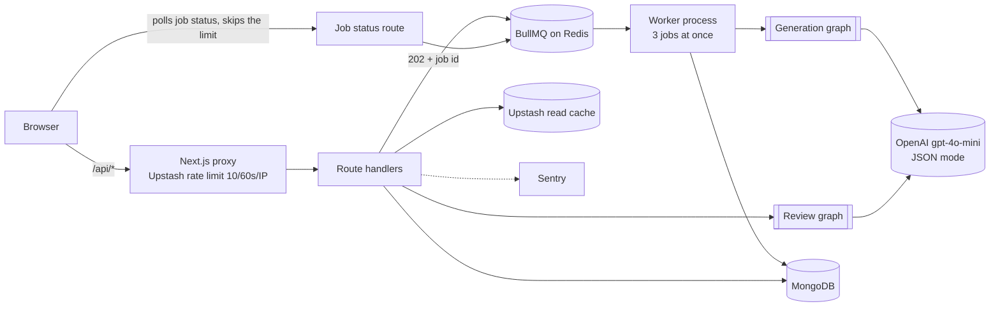
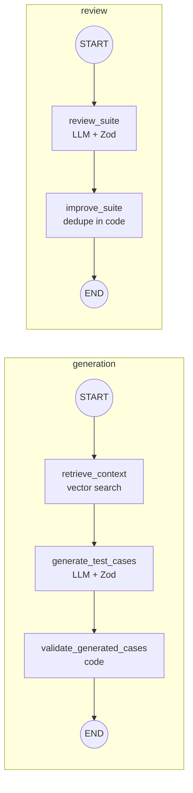

<div align="center">

# TestMind

**An AI QA engineering workspace.** Describe a feature like a ticket and get back a reviewed, deduplicated test suite of happy, negative and edge cases. Every model call is schema-checked and traced.

[**Live demo →**](https://testmind-production.up.railway.app/) · [Architecture](https://testmind-production.up.railway.app/architecture) · [E2E test](tests/e2e/testmind-complete-flow.spec.ts)

`Next.js 16` · `React 19` · `TypeScript` · `LangGraph` · `OpenAI` · `Gemini` · `MongoDB` · `BullMQ` · `Redis` · `Playwright` · `Sentry` · `Docker`

<!-- Add screenshots: docs/suite.png (suite page with a finished pipeline trace) and docs/architecture.png -->

</div>

---

## Architecture



Generation runs in the background because a model call takes seconds. The API answers straight away and a separate worker does the slow part. Reviews still run inside the request.

## The problem

Writing test cases is slow, and the cases people skip are the negative and edge ones. LLMs can draft them, but raw model output is unreliable: wrong shapes, duplicates, made-up fields. TestMind treats the model as **one unreliable step inside a deterministic pipeline**.

## What it does

1. **Describe:** write the feature spec.
2. **Generate:** a LangGraph workflow finds similar saved cases in the project, drafts 1–8 cases (happy / negative / edge) with that context and validates them against a schema.
3. **Review:** a second workflow scores coverage from 0 to 100, names the missing areas and proposes new cases.
4. **Improve:** accept suggestions. They're merged and deduped in code. The next generation sees the last review, so regeneration targets the gaps.
5. **Export:** download JSON or a **Playwright spec skeleton** with one `test()` per case and steps as `test.step`.

Each run shows a **live pipeline trace**: the graph's nodes, how long each took, the model, and the token count, reported by the server.

## How each run works



### Engineering decisions

| Decision | Why | Where |
|---|---|---|
| **LangGraph instead of one chain** | Typed shared state lets me validate between steps, add the review loop without touching generation, and trace each node. | [`src/lib/ai/graph`](src/lib/ai/graph) |
| **One topology module** | The compiled graphs and the UI diagram import the same node list, so the diagram can't drift from the code. | [`topology.ts`](src/lib/ai/graph/topology.ts) |
| **Per-node tracing** | A wrapper records duration, model and token usage into an append-only state channel. The API returns it and the UI renders it. | [`trace.ts`](src/lib/ai/graph/trace.ts) |
| **JSON mode + Zod** | Bad model output fails the run instead of reaching the UI or the database. | [`schemas/`](src/lib/ai/schemas) |
| **Deterministic post-processing** | Normalization and dedupe (type + normalized title) are plain code, not prompts: testable and free. | [`utils/test-case.ts`](src/lib/ai/utils/test-case.ts) |
| **Persist only after a clean run** | Orchestrators throw if any node reported an error, so there are no half-written suites. | [`suite-orchestrator/`](src/lib/ai/services/suite-orchestrator) |
| **Edge rate limiting** | Upstash fixed window in the Next.js proxy protects the LLM budget. | [`proxy.ts`](src/proxy.ts) |
| **Background worker for generation** | A model call takes seconds. The API returns a job id immediately, and concurrency stays capped at 3 however many requests arrive. | [`generation-worker.ts`](src/worker/generation-worker.ts) |
| **Gemini fallback** | If OpenAI fails, times out or returns output that fails the Zod schema, Gemini serves the same prompt. There are no retries before the switch, so an outage costs one attempt. | [`complete-json.ts`](src/lib/ai/llm/complete-json.ts) |
| **RAG over saved test cases** | Each saved case is one chunk with a 256 dimension embedding. Before writing, Atlas Vector Search finds similar cases inside the same project, filtered in the search itself, and the top 5 above a minimum score go to the model as data, so it can match the project's style and cover new ground. A regenerated suite skips its own cases. If the embedding or search fails, generation runs without context. Turned on with `RAG=on`. | [`rag/`](src/lib/ai/rag) |
| **Vector cache in Redis** | When turned on, a new suite whose feature is near identical to an earlier one in the project reuses its cases instead of paying for a model call. Vectors are compared in Node, so it works on any Redis, and each project is capped at 200 entries. | [`semantic-cache.ts`](src/lib/ai/cache/semantic-cache.ts) |
| **Polling instead of SSE** | It survives proxies and restarts and needs no open connection, at the cost of up to 1.5s extra delay. The status route only reads job state, so it skips the rate limit. | [`generate-tests.ts`](src/app/lib/generate-tests.ts) |
| **Separate Redis for the queue** | BullMQ needs a TCP connection, which Upstash REST doesn't offer, and its constant polling doesn't suit per-command pricing. | [`generation-queue.ts`](src/lib/queue/generation-queue.ts) |
| **Redis read cache** | Suite and project reads are cached with `s-maxage` / `stale-while-revalidate` and an `X-Cache` marker. | [`cache.ts`](src/lib/cache.ts) |

### Results

List cache on `GET /api/suites`, measured locally on 2026-11-09 with `npm run bench:cache`. Raw summaries are in [`benchmarks/results`](benchmarks/results).

| | Cache off | Cache on |
|---|---|---|
| Median throughput | 159 req/s | 234 req/s |
| Range throughput, 3 runs | 152 to 163 req/s | 186 to 235 req/s |
| Median p50 latency | 294 ms | 198 ms |
| Median p99 latency | 491 ms | 449 ms |
| Failed requests | 0 | 0 |

autocannon sent 50 connections for 30 seconds per run, against one Next.js process with local MongoDB and Redis and 30 suites of 8 cases each. `upstash-local.mjs` serves the Upstash REST API on top of local Redis, and each request sends a different `x-real-ip` so the rate limiter runs without rejecting the load.

These are local numbers, not production numbers. An Apple M2 laptop ran the app and the load generator, MongoDB was on the same machine, and production runs 2 web processes.

#### Load test with k6

`npm run bench:load` runs the production build with the same parts as Railway: the Next.js server, the BullMQ queue on Redis and the generation worker (3 jobs at a time). MongoDB, Redis and the Upstash REST API are local. [`mock-openai.mjs`](benchmarks/mock-openai.mjs) stands in for OpenAI, so a run costs nothing and measures TestMind rather than the model. Measured on 2026-11-10. Raw k6 summaries are in [`benchmarks/results`](benchmarks/results) (`load-*.json`).

Each run lasts 60 seconds with two kinds of traffic at once. 50 signed in readers open the home page and their project list. Every second, 2 new generations start and poll until the worker finishes them.

**Model answers at once** (3 runs, median with range):

| | Result |
|---|---|
| Requests served | 89.5 req/s (89.0 to 90.9), 0 failed |
| Generations finished | 121 of 121 per run (120 in one), 0 failed |
| Generation, start to saved suite | median 557 ms, p95 729 ms. The page polls every 500 ms, so this includes up to one poll wait |
| `POST /api/generate-tests` | median 21 ms, p95 188 ms |
| `GET /api/projects` | median 46 ms, p95 144 ms |
| Home page | median 76 ms, p95 196 ms |

**Model takes 8 seconds per answer**, close to a real call (1 run):

| | Result |
|---|---|
| Generations | 31 finished. 42 were refused with a 503 once 50 jobs were waiting, as designed, instead of piling up |
| Worker throughput | 31 in about 90 seconds, which matches 3 jobs at a time at 8 seconds each |
| Readers during the backlog | home p95 260 ms, project list p95 163 ms, 0 failed |

These are local numbers on one machine: an Apple M2 with 8 GB ran the app, the worker, MongoDB, Redis and k6 together, with one web process. Production runs 2 web processes and talks to Atlas and Upstash over the network, so live latency will be higher. Each request sends its own `x-real-ip`, so the rate limiter runs on every request without rejecting the load.

**Capacity of one web process** (`MODE=capacity npm run bench:load`). k6 sends `GET /api/projects` at a fixed rate for 30 seconds, then the next rate up. Raw steps are in `capacity-*.json`.

| Rate asked | Rate served | p50 | p95 | Failed |
|---|---|---|---|---|
| 100 req/s | 100 req/s | 4 ms | 7 ms | 0% |
| 200 req/s | 200 req/s | 27 ms | 350 ms | 0% |
| 250 req/s | 250 req/s | 76 ms | 362 ms | 0% |
| 300 req/s | 296 to 300 req/s | 14 to 211 ms | 312 to 641 ms | 0% |
| 350 req/s | 290 req/s | 1,070 ms | 2,426 ms | 3.4% |
| 400 req/s | 291 req/s | 1,030 ms | 3,521 ms | 16.9% |

Rows up to 250 come from one run, 350 and 400 from a second, and 300 shows both. One process holds 300 signed in list requests a second with p95 under 700 ms and nothing failed. Above that it tops out near 290 req/s and latency climbs past 2 seconds, so 300 req/s is the ceiling on this machine. Production runs 2 web processes.

**Fallback when OpenAI fails** (`MODE=fallback`). The mock fails a share of OpenAI answers with a 500, and Gemini (also mocked) takes over. Same 60 second mixed load as above. Raw results are in `fallback-*.json`, with the mock's count of answers per provider.

| OpenAI failing | Generations finished | Served by Gemini | Generation p95 |
|---|---|---|---|
| 50% | 120 of 120 | 60 | 676 ms |
| 100% | 121 of 121 | 121 | 628 ms |

Every generation finished, and a failed OpenAI call goes straight to Gemini with no retry first.

**Home page in Lighthouse 13.6** (`MODE=lighthouse`), against the local production build. Raw scores are in `lighthouse-*.json`.

| | Mobile | Desktop |
|---|---|---|
| Performance | 100 | 100 |
| Accessibility | 90 | 90 |
| Best practices | 96 | 96 |
| SEO | 80 | 80 |
| Largest contentful paint | 765 ms | 204 ms |
| Total blocking time | 0 ms | 0 ms |
| Layout shift | 0 | 0 |

Mobile uses Lighthouse's simulated slow 4G and a slower CPU. The server was on the same machine, so there is no real network distance.

**Cost per suite.** Two live generations used 1,482 and 1,374 tokens, as shown on the run itself, including the review step. At gpt-4o-mini's listed price of $0.15 per million input tokens and $0.60 per million output tokens, a suite costs at most $0.0009, even if every token were billed at the output rate. That is over 1,100 suites per dollar.

Generation queue, measured locally with a stubbed 5-second model:

| | Result |
|---|---|
| `POST /api/generate-tests` | 5.05 s held open before, **10 ms** now |
| 20 simultaneous requests | All accepted in 187 ms total, never more than 3 model calls at once |
| Worker killed with `kill -9` mid-job | Job finished after a restart, 64 s later, with one suite saved |
| Redis unreachable | Clean 503 in about 3 s |

## Testing

The Playwright test drives the real UI end to end: create project → add feature → generate → review → accept a suggestion. It intercepts the AI routes with fixtures, so it's **deterministic, fast and costs nothing**. The fixtures deliberately include malformed shapes (uppercase types, a non-array `suggestions`) to prove the UI tolerates them.

The other specs cover API validation, the rate limiter and project creation. They need no model or live service.

```bash
npm run test:e2e
```

## Production

- **Docker:** multi-stage build of Next's `standalone` output ([`Dockerfile`](Dockerfile))
- **PM2:** the web app in cluster mode with 2 instances, plus 1 generation worker, each restarting at 350 MB ([`ecosystem.config.js`](ecosystem.config.js))
- **Sentry:** client, server and edge, tunneled via `/monitoring`
- **Hosting:** Railway

## Benchmarks & Architecture Verification

Each row links to the code and to what checks it.

| Claim | Code | Evidence |
|---|---|---|
| LangGraph generate and review flow | [suite-generation.graph.ts](src/lib/ai/graph/workflows/suite-generation.graph.ts), [suite-review.graph.ts](src/lib/ai/graph/workflows/suite-review.graph.ts) | [Playwright full flow](tests/e2e/testmind-complete-flow.spec.ts) |
| OpenAI with Gemini fallback | [complete-json.ts](src/lib/ai/llm/complete-json.ts), [gemini.ts](src/lib/ai/llm/gemini.ts) | `npm run test:unit` |
| Redis exact cache throughput | [run-cache-benchmark.mjs](benchmarks/run-cache-benchmark.mjs) | [raw runs](benchmarks/results) |
| RAG retrieval | [retrieve.ts](src/lib/ai/rag/retrieve.ts), [chunks.ts](src/lib/ai/rag/chunks.ts), [index definition](atlas/test-case-chunks-vector-index.json) | `npm run test:unit`, and `npm run eval:rag` for hit@3, recall@5 and each minimum score on a [labelled set](evals/rag/dataset.json) of 22 cases and 16 queries, with [results](evals/rag/results.json). The eval ranks in process with the same embeddings and score formula |
| RAG effect on generated cases | [run-eval.ts](evals/rag-quality/run-eval.ts), [dataset](evals/rag-quality/dataset.json) | `npm run eval:rag-quality`. Local A/B on a written dataset of 40 saved cases and 20 features, 3 runs per mode, also used to tune the prompt: project rules covered 20% to 71% under the stricter check, stated rules 100% to 99%, cases close to a saved case 0.7% to 14%. [Results](evals/rag-quality/results-v3.json), [stricter check](evals/rag-quality/results-v3-strict.json) |
| RAG on a held out dataset | [dataset](evals/rag-quality/holdout-dataset.json), committed before the run | Clinic and pharmacy domain the prompt was never tuned on, 40 saved cases and 20 features, 3 runs per mode: project rules covered 6% to 56% under the stricter check, stated rules 100% in both, cases close to a saved case 1% to 22%. [Results](evals/rag-quality/holdout.json), [stricter check](evals/rag-quality/holdout-strict.json) |
| Redis vector cache | [semantic-cache.ts](src/lib/ai/cache/semantic-cache.ts) | `npm run test:unit`. Enable with `SEMANTIC_CACHE=on` |
| BullMQ generation queue | [generation-queue.ts](src/lib/queue/generation-queue.ts), [generation-worker.ts](src/worker/generation-worker.ts) | Measurements under Results above |
| Load test of the full stack | [run-load-test.mjs](benchmarks/run-load-test.mjs), [k6 script](benchmarks/load/k6-load.js), [mock OpenAI](benchmarks/mock-openai.mjs) | `npm run bench:load`, [raw k6 summaries](benchmarks/results) |
| Capacity, fallback and Lighthouse | [capacity script](benchmarks/load/k6-capacity.js), same runner with `MODE=capacity`, `fallback` or `lighthouse` | [raw results](benchmarks/results) |
| Zod request validation | [request-schemas.ts](src/lib/api/request-schemas.ts) | [API validation spec](tests/e2e/api-validation.spec.ts) |
| Rate limiting | [proxy.ts](src/proxy.ts) | [Rate limit spec](tests/e2e/rate-limit.spec.ts) |
| Projects flow | | [Projects spec](tests/e2e/projects.spec.ts) |
| Multi stage Docker build | [Dockerfile](Dockerfile), [Dockerfile.dev](Dockerfile.dev) | `docker build .` |

The benchmark runs locally and compares cache on and off.

## What I'd do next

- **Stream node progress** over SSE so each node lights up as it finishes. Today the trace arrives when the run ends.
- **Prompt regression evals** in CI: a fixed set of specs with expected coverage.
- **Per-route limits:** a cheap read shouldn't cost the same as an LLM call.
- **Auth and multi-tenancy:** projects are global today.

## Run locally

```bash
git clone https://github.com/vini1237777/TestMind.git && cd TestMind
npm install
cp .env.example .env.local   # fill in the values
npm run dev
npm run worker   # in a second terminal, needs REDIS_URL
```

| Variable | Used for |
|---|---|
| `OPENAI_API_KEY` | generation and review |
| `GEMINI_API_KEY` | fallback for generation and review (optional) |
| `SEMANTIC_CACHE`, `SEMANTIC_CACHE_THRESHOLD` | turn on the vector cache, and its similarity cutoff (optional, off by default) |
| `MONGODB_URI` | persistence |
| `UPSTASH_REDIS_REST_URL`, `UPSTASH_REDIS_REST_TOKEN` | rate limiting and cache |
| `REDIS_URL` | generation queue (TCP Redis, not the Upstash REST URL) |
| `NEXT_PUBLIC_SENTRY_DSN`, `SENTRY_DSN` | error monitoring (optional) |

```bash
docker build -t testmind . && docker run -p 8080:8080 --env-file .env.local testmind
```

---

Built by [Vinisha Yadav](https://github.com/vini1237777).
